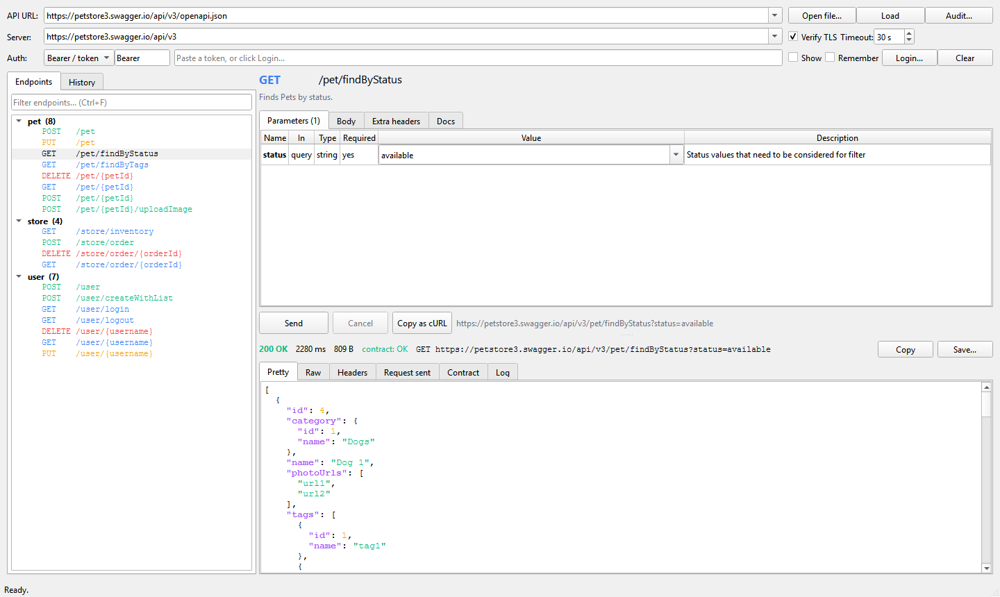
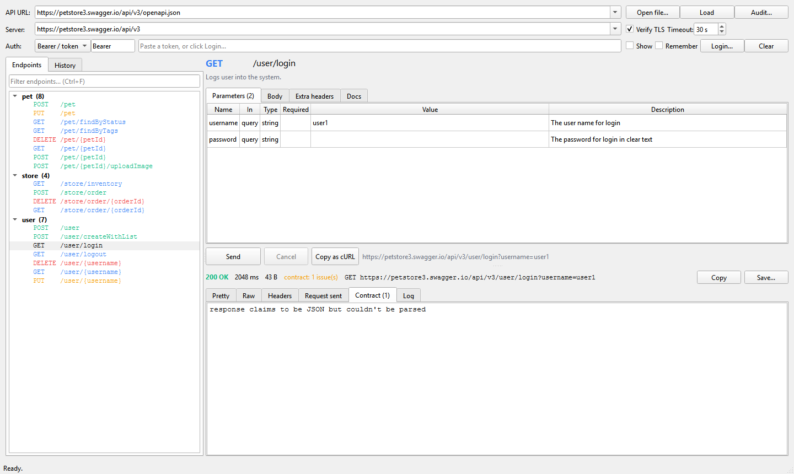
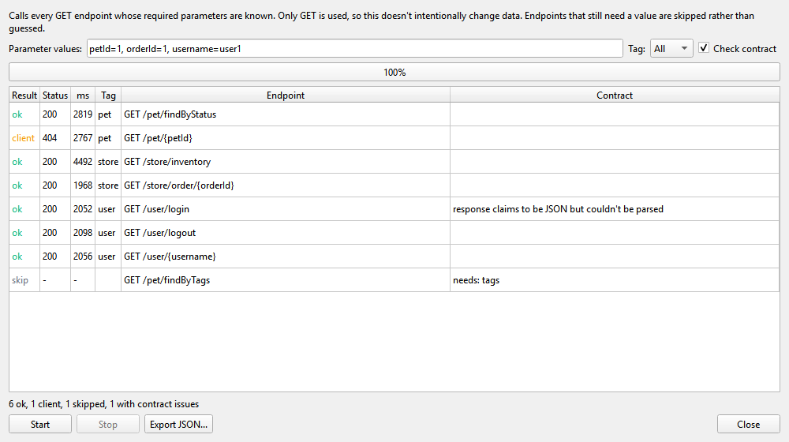
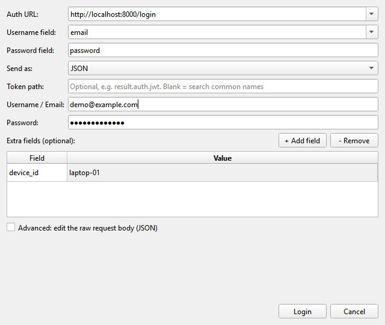

# SpecProbe

Test any REST API that has an OpenAPI or Swagger spec, from a desktop app or the command line.

Paste a docs page, a spec URL, a bare host or a local file. SpecProbe finds the spec, lists the endpoints, builds requests for you, and checks each response against what the spec promises. It isn't tied to any framework or backend.

- **Finds the spec for you.** It reads what the docs page declares (FastAPI, Swashbuckle, springdoc, swagger-ui-express, drf-spectacular, drf-yasg, ReDoc, Scalar) and falls back to the conventional locations.
- **Swagger 2.0, OpenAPI 3.0 and 3.1**, in JSON or YAML, including `$ref`s, server variables and path-level parameters.
- **Every common auth style:** Bearer or any token scheme, Basic, API key (header, query or cookie), JSON or OAuth2 form logins, and cookie sessions.
- **Every common body type:** JSON, urlencoded forms, multipart file uploads and raw text.
- **Contract checks.** See when a response's status or shape doesn't match the spec.
- **Audit.** Sweep all GET endpoints in one go, with exit codes suitable for CI.
- **Copy any request as cURL.**

<picture>
  <source media="(prefers-color-scheme: dark)" srcset="https://raw.githubusercontent.com/Basheer009/specprobe/HEAD/docs/screenshots/main-dark.png">
  
</picture>

## Install

Requires Python 3.10 or newer.

```bash
git clone https://github.com/Basheer009/specprobe.git
cd specprobe
python -m venv .venv
source .venv/bin/activate        # Windows: .venv\Scripts\activate

pip install ".[gui]"             # desktop app and CLI
# or: pip install .              # CLI only, without the ~250 MB Qt download
```

This gives you two commands: `specprobe-gui` and `specprobe`.

**Windows shortcut:** run `setup.bat` once, then use `run.bat` for the app and `cli.bat` for the CLI. They work from any directory.

## Desktop app

```bash
specprobe-gui                                # or run.bat on Windows
specprobe-gui https://api.example.com/docs   # load straight away
```

1. Paste a URL into **API URL** and press Enter, or use **Open file...** for a spec on disk.
2. If the API needs auth, choose the type (the spec's declared scheme is preselected) or click **Login...**.
3. Pick an endpoint, fill in **Parameters** and **Body** (**Insert example** builds one from the schema), and press **Ctrl+Enter**.

The status line shows the result along with `contract: OK` or the number of issues, which are listed on the **Contract** tab.

<picture>
  <source media="(prefers-color-scheme: dark)" srcset="https://raw.githubusercontent.com/Basheer009/specprobe/HEAD/docs/screenshots/contract-dark.png">
  
</picture>

| Area | What it does |
|---|---|
| **Server** | The base URL requests go to. Lists every server in the spec, and you can type another. Needed when a spec file doesn't name a host. |
| **Parameters** | Required fields are bold and tinted while empty. Enums and booleans get a dropdown. Type array values comma-separated; they're sent in the format the spec declares. |
| **Body** | Choose among the spec's content types. Forms are written as a JSON object. In multipart, `"field": "@/path/to/file"` uploads that file. |
| **Extra headers** | Sent on every request to this API, for things the spec doesn't document. |
| **Docs** | The operation's description and example responses. |
| **History** | This session's requests. Click one to restore both the request and its response. |
| **Audit...** | Runs the GET sweep and can export a JSON report. |
| **Log** | A trace of what was sent, with secrets redacted. |

Your edits to an endpoint are kept when you switch to another. A path value is carried across endpoints that share the same path prefix, so `/tenants/{id}` and `/tenants/{id}/users` share one, while `/orders/{id}` doesn't inherit from `/users/{id}`.

| Shortcut | Action |
|---|---|
| `Ctrl+L` | Focus the API URL |
| `Ctrl+R` | Reload the spec |
| `Ctrl+F` | Filter endpoints |
| `Ctrl+Enter` | Send |

The app follows your system's light or dark theme. The screenshots here switch with your browser's theme too.

### Audit

**Audit...** calls every GET endpoint whose required values it knows, and skips the rest rather than guessing. Give it values such as `petId=1, username=user1` to cover more endpoints. It's the same sweep as the CLI's `audit`, and **Export JSON...** saves the report.

<picture>
  <source media="(prefers-color-scheme: dark)" srcset="https://raw.githubusercontent.com/Basheer009/specprobe/HEAD/docs/screenshots/audit-dark.png">
  
</picture>

### Login dialog

The dialog suggests login endpoints from the spec and fills in what the endpoint's schema reveals, such as the username field, form or JSON encoding, and other required fields. You can change any of it.

<picture>
  <source media="(prefers-color-scheme: dark)" srcset="https://raw.githubusercontent.com/Basheer009/specprobe/HEAD/docs/screenshots/login-dark.png">
  
</picture>

- **Send as:** JSON, or form-encoded for the OAuth2 password grant (FastAPI's `OAuth2PasswordRequestForm`, for example).
- **Token path:** only needed for unusual responses, e.g. `result.auth.jwt`. Otherwise common names are searched at any depth, and an `Authorization` response header or a session cookie also counts as a successful login.
- **Extra fields:** for logins that need more than a username and password, such as a tenant or device ID.
- **Advanced:** edit the raw JSON body.

If the login is rejected for validation reasons, the dialog reads the error (DRF, FastAPI, ASP.NET and Laravel shapes) and offers to add the missing fields or correct the username field.

### Settings and credentials

Settings are saved per API host: chosen server, auth type, extra headers and login form values. Credentials never carry over when you load a different API.

Passwords are never saved. Tokens and keys are saved only if you tick **Remember**, and then **unencrypted** in your user settings (the registry on Windows, a config file elsewhere), so leave it off on shared machines.

## Command line

```
specprobe --url <URL> [global flags] <spec|show|call|login|audit> [flags]
```

Global flags go **before** the subcommand. Output on stdout is JSON unless you pass `--table`, and diagnostics go to stderr. `--url` also accepts a local file, or comes from `$SPECPROBE_URL`.

| Global flag | Meaning |
|---|---|
| `--no-verify` | Skip TLS verification (self-signed dev certificates) |
| `--base URL` | Override the server URL from the spec |
| `--token T` | Bearer token, or `$SPECPROBE_TOKEN` |
| `--token-prefix P` | Scheme word for `--token`: `Bearer` by default, `Token` for DRF TokenAuth, `""` for none |
| `--basic USER:PASS` | HTTP Basic |
| `--api-key NAME=VALUE` | API key, with `--api-key-in header\|query\|cookie` |
| `--header NAME=VALUE` | Extra header (repeatable) |
| `--cookie NAME=VALUE` | Cookie (repeatable) |
| `-v`, `--verbose` | Trace requests to stderr, with secrets redacted |

### `spec`: list endpoints

```bash
specprobe --url https://api.example.com/docs spec --table
specprobe --url ./openapi.yaml spec --filter users --method GET
```

### `show`: inspect one endpoint

```bash
specprobe --url ... show --method POST --path /users
```

### `call`: send a request

```bash
# Path and query parameters
specprobe --url ... call --method GET --path "/users/{id}" --path-param id=42 --query expand=teams

# JSON body: inline, from a file, or generated from the schema
specprobe --url ... call --method POST --path /users --json-body '{"name": "Ann"}'
specprobe --url ... call --method POST --path /users --json-file user.json
specprobe --url ... call --method POST --path /users --example

# Form fields and file uploads
specprobe --url ... call --method POST --path /photos --form title=Cat --form image=@cat.png

# Check the response against the spec; a mismatch makes the exit code 1
specprobe --url ... call --method GET --path /users --validate

# Save a binary response, or print the curl command instead of sending
specprobe --url ... call --method GET --path /report.pdf --output report.pdf
specprobe --url ... call --method GET --path /users --curl
```

Other options: `--body TEXT`, `--content-type`, `--raw`, `--full-headers`, `--timeout`.

### `login`: get a token

```bash
export SPECPROBE_TOKEN=$(specprobe --url https://api.example.com login \
  --auth-path /api/token/ --username ann --password-stdin --token-only < password.txt)
```

The password comes from `--password-stdin`, `$SPECPROBE_PASSWORD`, or a prompt. `--password` also works, but it's visible in shell history and process lists.

Options: `--username-field`, `--password-field`, `--extra k=v`, `--form` for form-encoded logins, and `--token-path`. If the server opens a cookie session instead of issuing a token, the cookies are printed so you can pass them with `--cookie`.

### `audit`: sweep the GET endpoints

```bash
specprobe --url ... --token "$SPECPROBE_TOKEN" audit --table --validate
specprobe --url ... audit --param version=1 --param tenant=acme --tag users --fail-on server
```

Only GET requests are sent. A required parameter is filled from `--param`, then from a default or example in the spec. Endpoints still missing a value are listed as skipped rather than called with invented data. Each result lands in a bucket: `ok`, `auth` (401/403), `client`, `server` or `error`.

Calls reuse connections, so there's one TLS handshake per host rather than one per endpoint. `--jobs N` keeps up to N requests in flight. The default is 1; raise it only for servers that can take the load. Results are reported in the same order either way.

`--fail-on` chooses what makes the exit code 1, which is what you want in CI:

| Value | Fails on |
|---|---|
| `none` (default) | Nothing |
| `server` | 5xx and connection errors |
| `client` | The above, plus 4xx |
| `any` | The above, plus 401/403 |

With `--validate`, contract issues also count, unless `--fail-on` is `none`.

### Exit codes

| Code | Meaning |
|---|---|
| `0` | Success |
| `1` | Failed call, failed `audit --fail-on`, or the spec couldn't be loaded |
| `2` | Failed login or bad usage |

## Troubleshooting

| Symptom | Fix |
|---|---|
| `Could not find an OpenAPI/Swagger spec` | Paste the spec's URL or a file path directly. In the GUI's **Log** tab, or with `-v`, you can see each location tried. |
| `needs authentication to read the spec` | Supply credentials before loading, or use a local copy of the spec. |
| TLS verification failed | For a self-signed development certificate, untick **Verify TLS** or pass `--no-verify`. For a private CA, set `REQUESTS_CA_BUNDLE` to its certificate file. |
| Requests go to the wrong host | The spec's `servers` or `host` is wrong for your environment. Change **Server** or pass `--base`. |
| Login succeeds, but no token is found | Set **Token path** or `--token-path`. |
| Git Bash says `--path` was rewritten | Git Bash turns `/x` into a Windows path. Set `MSYS_NO_PATHCONV=1` or write `//x`. |
| `Access is denied: ...Shiboken.pyd` during install | Antivirus locked a file during extraction. Run the install again. |

Proxies are honoured through the standard `HTTP_PROXY` and `HTTPS_PROXY` environment variables.

## Security notes

- A spec chooses which host requests go to. If that differs from where the spec was loaded, and you have credentials set, the GUI shows a warning and the CLI prints one.
- When loading a spec, credentials are sent only to the origin of the URL you entered, never to another origin that a page refers to.
- Text from specs and servers is treated as untrusted and displayed as plain or escaped text.
- A spec can't make the tool upload a local file: `@` prefixes in generated examples are stripped.
- **Copy as cURL** and `--curl` include your real credentials. The GUI's **Request sent** tab and the logs hide them.
- `audit` sends only GET, but a badly behaved API can still change state on a GET. Point it at environments you're allowed to test.

## Known limitations

- Interactive OAuth2 flows that need a browser (authorization code, device code) aren't built in. Get the token elsewhere and paste it in.
- External `$ref`s to other files or URLs aren't followed. Bundle the spec first.
- `servers` overrides at the path or operation level are ignored. Use **Server** or `--base`.
- If a docs page lists several specs, such as springdoc groups, only one is loaded: the UI's primary one, or else the first that has any operations. Paste the URL of the one you want.
- Contract checks ignore `format` (such as `email` or `date-time`) and `discriminator`.
- Generated cURL commands use POSIX shell quoting, which `cmd.exe` doesn't understand.

## Development

```bash
pip install -e ".[gui]"
python -m unittest discover -s tests -t .
```

The tests use only the standard library and need no network. They run against a local mock API that imitates how real frameworks publish their specs, and the GUI tests run headlessly on Qt's offscreen platform. Without PySide6 installed, the GUI tests are skipped.

| Path | Role |
|---|---|
| `specprobe/core.py` | All the logic: discovery, parsing, requests, auth, validation, audit |
| `specprobe/cli.py` | Command line |
| `specprobe/gui.py` | Desktop app |
| `tests/mock_api.py` | Local API used by the tests |

## License

[MIT](https://github.com/Basheer009/specprobe/blob/HEAD/LICENSE)
